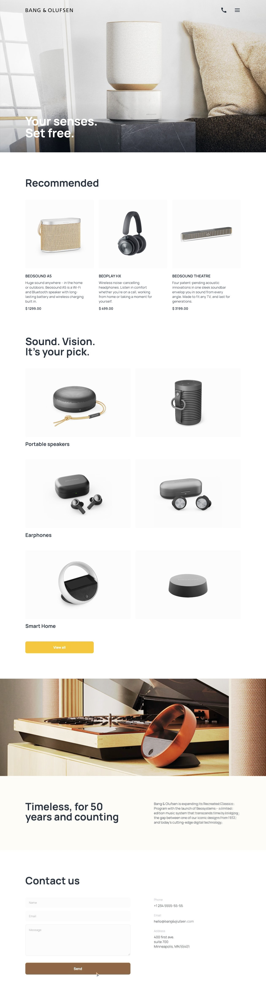
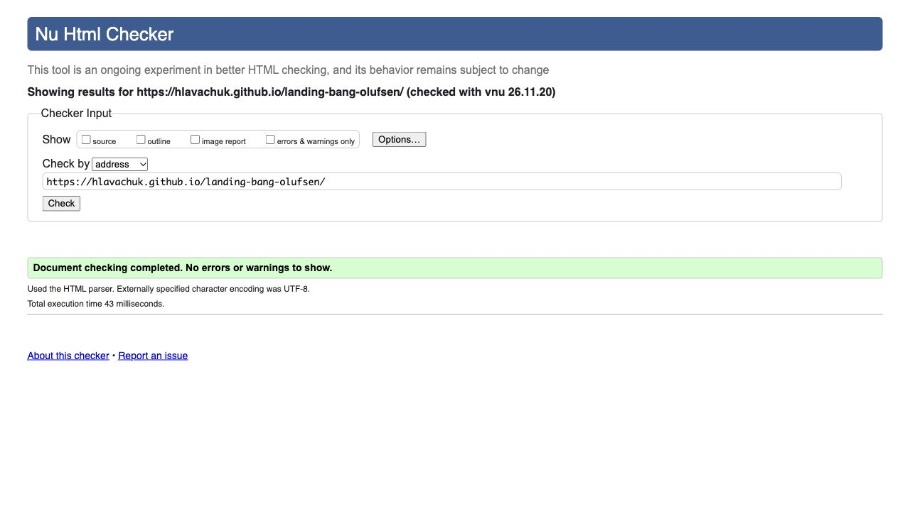
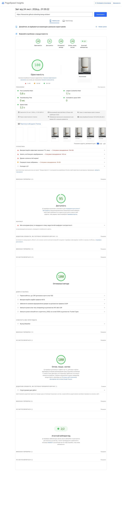
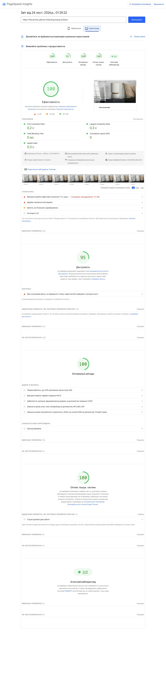

# Лабораторна робота №10 — Bang & Olufsen

Номер у списку: **13**. Варіант макета: **1**, оскільки `(13 − 1) % 3 + 1 = 1`. Методологія: **BEM + SMACSS**.

- [Опублікована сторінка](https://hlavachuk.github.io/landing-bang-olufsen/)
- [Макет Figma — сторінка B&O](https://www.figma.com/design/xIVUXiPZ3hdpEFiIC0qbTL/BOSE-New-Version)
- [Умова роботи](https://github.com/Computer-Science-Department-ChNU/web-technologies/blob/main/html-css/labs/lab-10/lab-10.adoc)

## Запуск

Потрібен Node.js 24.15 або новіший підтримуваний випуск.

```sh
npm install
npm run dev
npm run build
npm run preview
npm run lint
npm run format
npm run images
```

`dev` запускає локальний сервер; `build` створює `dist`; `preview` показує збірку. `lint` перевіряє SCSS і форматування, `format` форматує файли, `images` генерує оптимізовані зображення з `src/images`. Після встановлення залежностей Husky запускає lint-staged перед комітом.

## Завдання 1. Декомпозиція на BEM-блоки

Розмітка: [src/pages/index.pug](src/pages/index.pug), спільний документ: [src/layouts/main.pug](src/layouts/main.pug). Повторювані картки та зображення винесено в [src/mixins](src/mixins), дані товарів і категорій — у [src/data](src/data).

Блоки: `header`, `hero`, `menu`, `recommended`, `product-card`, `categories`, `category`, `timeless`, `contacts`, `contact-form`, `button`, `section-title`. Класи елементів мають вигляд `product-card__image`, модифікаторів — `button--dark`. Мікси `l-page__contacts` та інші задають зовнішнє розташування блоків.

## Завдання 2. Архітектура стилів

Точка входу: [src/styles/main.scss](src/styles/main.scss). Порядок SMACSS:

| Категорія    | Папка       | Призначення                                       |
| ------------ | ----------- | ------------------------------------------------- |
| Налаштування | `abstracts` | SCSS-токени та міксини медіазапитів               |
| Base         | `base`      | Скидання, шрифти, базові тегові правила           |
| Layout       | `layout`    | Контейнер, сітка, зовнішні відступи; префікс `l-` |
| Modules      | `modules`   | Окремий SCSS-файл для кожного BEM-блока           |
| State        | `state`     | Доступність і стани, префікс `is-`                |
| Theme        | `theme`     | Кольорові CSS-змінні                              |

У блоках немає ID-селекторів і `!important`. Stylelint контролює іменування класів та вкладеність до трьох рівнів. Prettier, Husky й lint-staged підтримують узгоджений стиль коду. Autoprefixer застосовується під час збірки відповідно до Browserslist.

## Завдання 3. Модульна сітка

Реалізація: [src/styles/layout/_l-grid.scss](src/styles/layout/_l-grid.scss), [src/styles/layout/_l-container.scss](src/styles/layout/_l-container.scss).

| Ширина      | Колонки | Проміжок | Поля                    |
| ----------- | ------- | -------- | ----------------------- |
| 320–743 px  | 2       | 20 px    | 20 px                   |
| 744–1259 px | 6       | 24 px    | 72 px                   |
| від 1260 px | 12      | 24 px    | 120 px на кадрі 1260 px |

Максимальна ширина контенту — 1020 px. На ширших екранах контейнер центрується. У галереї B&O фотографії займають по 6 колонок на десктопі, по 3 на планшеті й по 1 на телефоні. Товари на планшеті займають усі 6 колонок, на десктопі — по 4.

## Завдання 4. Ресурси та адаптивність

Зображення й іконки експортовано з макета; оригінали фотографій містяться в `src/images`, підготовлені ресурси — у `public/images`. Локальний шрифт — Manrope. Основні параметри: колір тексту `#1b2129`, акцент `#f98921`, фон інформаційного блока `#fcfaef`, основний текст 16 px з міжрядковим інтервалом 140%.

`picture` використовує AVIF, WebP і JPEG, `srcset` із ширинами та `sizes`. Для різних кадрів використано окреме кадрування. Hero завантажується з високим пріоритетом, нижні фотографії — ліниво. Розміри зображень задано явно. Меню відкривається через `:target`, без клієнтського JavaScript. Посилання, поля та кнопки мають стани фокуса; поля — підписи та стандартну HTML-валідацію. Форма демонстраційна, сервер обробки не підключено.

## Завдання 5. Звіряння з макетом

Еталони Figma збережено в [docs/reference](docs/reference). Знімки сторінок і накладання з прозорістю 50% дозволяють порівняти розміри, позиції та відступи. Накладання створені зі скриншотів і експортів Figma, без розтягування сторінки.

| Ширина  | Сторінка                                   | Накладання                                      |
| ------- | ------------------------------------------ | ----------------------------------------------- |
| 320 px  | [Скриншот](docs/screenshots/page-320.jpg)  | [Накладання](docs/screenshots/overlay-320.jpg)  |
| 744 px  | [Скриншот](docs/screenshots/page-744.jpg)  | [Накладання](docs/screenshots/overlay-744.jpg)  |
| 1260 px | [Скриншот](docs/screenshots/page-1260.jpg) | [Накладання](docs/screenshots/overlay-1260.jpg) |



[Відкрите мобільне меню](docs/screenshots/menu-320.jpg). Перевірено відкривання меню та перехід до секції клавіатурою, завантаження зображень і відсутність горизонтального переповнення на трьох контрольних ширинах.

## Завдання 6. Валідація та PageSpeed

W3C: **0 помилок, 0 попереджень**. [Перевірити опубліковану сторінку](https://validator.w3.org/nu/?doc=https%3A%2F%2Fhlavachuk.github.io%2Flanding-bang-olufsen%2F). [Машинний звіт перевірки HTML](docs/checks/w3c-source.json).



[Звіт PageSpeed Insights](https://pagespeed.web.dev/analysis/https-hlavachuk-github-io-landing-bang-olufsen/ou48dl1mbzcz65wt6qe566?form_factor=mobile).

| Режим   | Performance | Accessibility | Best Practices | SEO |
| ------- | ----------- | ------------- | -------------- | --- |
| Mobile  | 100         | 95            | 100            | 100 |
| Desktop | 100         | 95            | 100            | 100 |

Оцінки зафіксовані під час перевірки; повторний запуск може дати інші значення. Оцінка доступності 95 пов’язана з контрастністю окремих кольорів оригінального макета.





## Завдання 7. Публікація

[GitHub Actions](.github/workflows/pages.yml) встановлює залежності через `npm ci`, перевіряє код, збирає сайт і публікує `dist` у GitHub Pages. У `vite.config.js` задано базовий шлях `/landing-bang-olufsen/`. `node_modules` та `dist` виключено з репозиторію, `package-lock.json` збережено.
